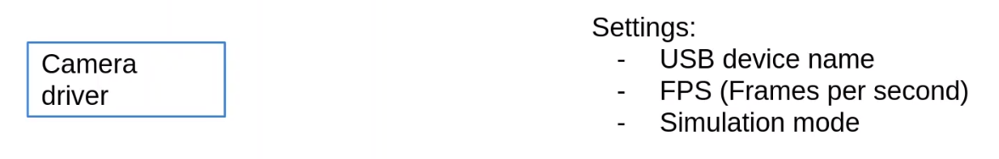
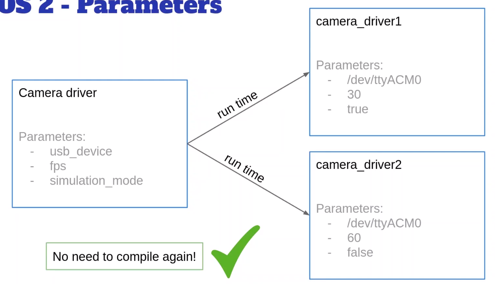

# 什么是ROS2参数

> 相机驱动节点

  

- 如果想运行相机，但usb设备名称与代码中不同，那就***必须更改代码中设置***，并在需要时重新构建包  
- 如果想每秒30帧而不是每秒60帧就不得不再次更改代码  
- 如果想运行该节点两次，一次对某一台相机使用仿真，另一台相机使用真实模式，不得不复制整个代码

> 所以，把这些东西硬编码到代码中不是一个好的选择

- 需要使用***ROS2参数***，是**节点的配置值**，适用于任何类型的设置
- 需要在代码中声明这些参数，然后在启动节点时设置它们的值

 

> 这些值会在代码中设置，以便节点可以使用它们
> 可以在每次启动都使用不同的值 ~~不需要触碰代码，也不需要重新编译，只需要在运行时提供参数值~~ 

## 总结

- ROS2参数用于为你的节点提供设置，并且在运行时设置它们的值
- 参数是用于某个节点的，仅在节点存活期间存在
- 两个不同节点将（可以）拥有两组不同的参数值
- ROS参数具有名称和数据类型
    - Boolean
    - Int
    - Double
    - String
    - Lists

