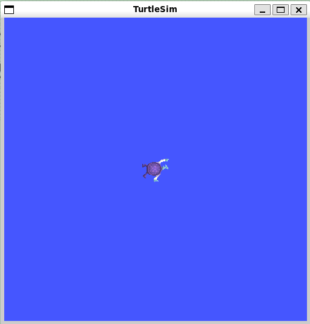
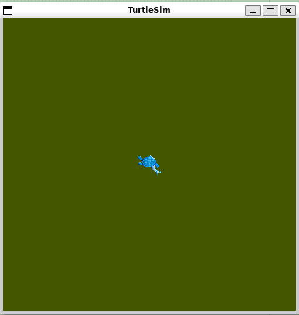

> 使用turtlesim 进行实验，发现更多用于ros2参数的命令行工具。了解那些无法访问代码的现有节点中的参数进行交互

> 查看某个包中有哪些程序

```bash
╭─ ~/HelloROS2/ros2_ws main
╰─❯ ros2 pkg executables turtlesim
turtlesim draw_square
turtlesim mimic
turtlesim turtle_teleop_key
turtlesim turtlesim_node
```

> 启动小乌龟

```bash
╭─ ~/HelloROS2/ros2_ws main
╰─❯ ros2 run turtlesim turtlesim_node
WARNING: CPU random generator seem to be failing, disabling hardware random number generation
WARNING: RDRND generated: 0xffffffff 0xffffffff 0xffffffff 0xffffffff
[INFO] [1791711173.536204158] [turtlesim]: Starting turtlesim with node name /turtlesim
[INFO] [1791711173.588563068] [turtlesim]: Spawning turtle [turtle1] at x=[5.544445], y=[5.544445], theta=[0.000000]
```

  

> 列出所有参数

```bash
╭─ ~/HelloROS2/ros2_ws main
╰─❯ ros2 param list
/turtlesim:
  background_b
  background_g
  background_r
  holonomic
  qos_overrides./parameter_events.publisher.depth
  qos_overrides./parameter_events.publisher.durability
  qos_overrides./parameter_events.publisher.history
  qos_overrides./parameter_events.publisher.reliability
  #下面这两个参数其他节点也有
  start_type_description_service
  use_sim_time
  
╭─ ~/HelloROS2/ros2_ws main           3s
╰─❯ ros2 node list
/turtlesim

```

> 启动另一个节点作为对比

```bash
╭─ ~/HelloROS2/ros2_ws main
╰─❯ ros2 run my_py_pkg py_node
[INFO] [1791711523.066833780] [py_test]: Hello world

╭─ ~/HelloROS2/ros2_ws main
╰─❯ ros2 param list
/py_test:
  start_type_description_service
  use_sim_time
/turtlesim:
  background_b
  background_g
  background_r
  holonomic
  qos_overrides./parameter_events.publisher.depth
  qos_overrides./parameter_events.publisher.durability
  qos_overrides./parameter_events.publisher.history
  qos_overrides./parameter_events.publisher.reliability
  start_type_description_service
  use_sim_time
```

```bash
#获取的是当前运行中的节点参数值
╭─ ~/HelloROS2/ros2_ws main
╰─❯ ros2 param get /turtlesim background_g
Integer value is: 86

#设置其他值
╭─ ~/HelloROS2/ros2_ws main          38s
╰─❯ ros2 run turtlesim turtlesim_node --ros-args -p background_g:=123
WARNING: CPU random generator seem to be failing, disabling hardware random number generation
WARNING: RDRND generated: 0xffffffff 0xffffffff 0xffffffff 0xffffffff
[INFO] [1791711809.702387565] [turtlesim]: Starting turtlesim with node name /turtlesim
[INFO] [1791711809.740583374] [turtlesim]: Spawning turtle [turtle1] at x=[5.544445], y=[5.544445], theta=[0.000000]

╭─ ~/HelloROS2/ros2_ws main
╰─❯ ros2 param get /turtlesim background_g
Integer value is: 123
```

> 修改background_b为0

```bash
╭─ ~/HelloROS2/ros2_ws main
╰─❯ ros2 run turtlesim turtlesim_node --ros-args -p background_b:=0
WARNING: CPU random generator seem to be failing, disabling hardware random number generation
WARNING: RDRND generated: 0xffffffff 0xffffffff 0xffffffff 0xffffffff
[INFO] [1791711914.114523193] [turtlesim]: Starting turtlesim with node name /turtlesim
[INFO] [1791711914.176772446] [turtlesim]: Spawning turtle [turtle1] at x=[5.544445], y=[5.544445], theta=[0.000000]

╭─ ~/HelloROS2/ros2_ws main        ✘ INT
╰─❯ ros2 param get /turtlesim background_b
Integer value is: 0
```


  

> 所以，参数可以在不需要编译代码也不需要查看代码的情况下修改程序行为

> 查看服务

```bash
╭─ ~/HelloROS2/ros2_ws main
╰─❯ ros2 service list
/clear
/kill
/reset
/spawn
/turtle1/set_pen
/turtle1/teleport_absolute
/turtle1/teleport_relative
#都是用于与参数功能交互的服务
/turtlesim/describe_parameters
/turtlesim/get_parameter_types
/turtlesim/get_parameters
/turtlesim/get_type_description
/turtlesim/list_parameters
/turtlesim/set_parameters
/turtlesim/set_parameters_atomically

#查看类型
╭─ ~/HelloROS2/ros2_ws main
╰─❯ ros2 service type /turtlesim/list_parameters
rcl_interfaces/srv/ListParameters

╭─ ~/HelloROS2/ros2_ws main
╰─❯ ros2 interface show rcl_interfaces/srv/ListParameters
# Recursively get parameters with unlimited depth.
uint64 DEPTH_RECURSIVE=0

# The list of parameter prefixes to query.
string[] prefixes

# Relative depth from given prefixes to return.
#
# Use DEPTH_RECURSIVE to get the recursive parameters and prefixes for each prefix.
uint64 depth

---
# The list of parameter names and their prefixes.
ListParametersResult result
        string[] names
        string[] prefixes

```

> 调用获取参数列表服务

> 如果再一个节点内（代码），与另一个节点的参数交互，就可以使用服务。 ~~知道服务名称，知道接口，知道如何创建客户端。如果你曾经想从另一个节点与某个节点的参数进行交互，可以使用这里的服务来实现。可以以编程的方式与参数进行交互~~ 

```bash
╭─ ~/HelloROS2/ros2_ws main
╰─❯ ros2 service list
/clear
/kill
/reset
/spawn
/turtle1/set_pen
/turtle1/teleport_absolute
/turtle1/teleport_relative
#都是用于与参数功能交互的服务
/turtlesim/describe_parameters
/turtlesim/get_parameter_types
/turtlesim/get_parameters
/turtlesim/get_type_description
/turtlesim/list_parameters
/turtlesim/set_parameters
/turtlesim/set_parameters_atomically
```

```bash
╭─ ~/HelloROS2/ros2_ws main
╰─❯ ros2 service call /turtlesim/list_parameters rcl_interfaces/srv/ListParameters
waiting for service to become available...
requester: making request: rcl_interfaces.srv.ListParameters_Request(prefixes=[], depth=0)

response:
rcl_interfaces.srv.ListParameters_Response(result=rcl_interfaces.msg.ListParametersResult(names=['background_b', 'background_g', 'background_r', 'holonomic', 'qos_overrides./parameter_events.publisher.depth', 'qos_overrides./parameter_events.publisher.durability', 'qos_overrides./parameter_events.publisher.history', 'qos_overrides./parameter_events.publisher.reliability', 'start_type_description_service', 'use_sim_time'], prefixes=['qos_overrides./parameter_events.publisher']))

#上面的服务调用，效果与下面这个一致
╭─ ~/HelloROS2/ros2_ws main
╰─❯ ros2 param list
/turtlesim:
  background_b
  background_g
  background_r
  holonomic
  qos_overrides./parameter_events.publisher.depth
  qos_overrides./parameter_events.publisher.durability
  qos_overrides./parameter_events.publisher.history
  qos_overrides./parameter_events.publisher.reliability
  start_type_description_service
  use_sim_time
  
```

