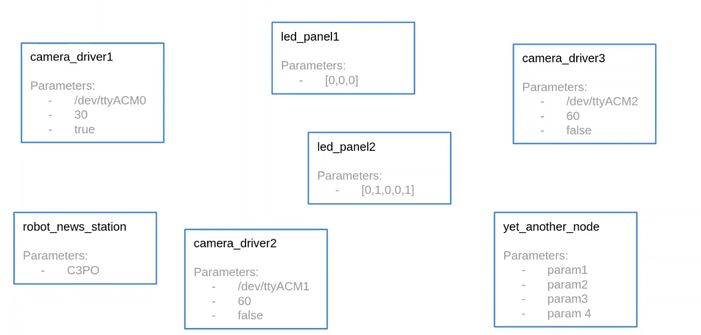
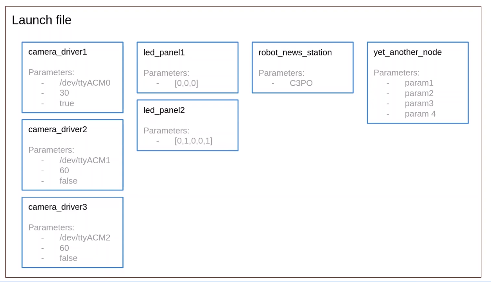

# 什么是ROS2启动文件

> 场景：有很多节点要启动。正常情况下，就需要每个节点都在自己的终端中运行，并带有命名节点、设置参数等所需的所有选项。这会变得非常混乱



> 此时，可以运行一个脚本来自动启动所有内容

> 把所有节点和配置都放入一个启动文件中，启动文件将允许你从单个文件中启动所有内容。可以启动节点、有一些重映射、设置一些参数，甚至加载yaml参数文件。这样就可以快速启动程序，并为机器人的不同启动模式创建不同的启动文件

> 实际应用中一个机器人拥有10个节点、200个或更多参数并不罕见。如果不使用启动文件，启动机器人应用程序将是不可能的



# 创建并安装一个启动文件

> 为启动文件创建一个专用的包

```bash
#--build-type ament_cmake 可以不添加默认就是这个
#明明 机器人名称+bringup
╭─ ~/HelloROS2/ros2_ws/src main
╰─❯ ros2 pkg create my_robot_bringup --build-type ament_cmake
going to create a new package
package name: my_robot_bringup
destination directory: /home/ly/HelloROS2/ros2_ws/src
package format: 3
version: 0.0.0
description: TODO: Package description
maintainer: ['ly <lwmfjc@gmail.com>']
licenses: ['TODO: License declaration']
build type: ament_cmake
dependencies: []
creating folder ./my_robot_bringup
creating ./my_robot_bringup/package.xml
creating source and include folder
creating folder ./my_robot_bringup/src
creating folder ./my_robot_bringup/include/my_robot_bringup
creating ./my_robot_bringup/CMakeLists.txt

[WARNING]: Unknown license 'TODO: License declaration'.  This has been set in the package.xml, but no LICENSE file has been created.
It is recommended to use one of the ament license identifiers:
Apache-2.0
BSL-1.0
BSD-2.0
BSD-2-Clause
BSD-3-Clause
GPL-3.0-only
LGPL-3.0-only
MIT
MIT-0

╭─ ~/HelloROS2/ros2_ws/src/my_robot_bringup main ?1
╰─❯ rm -rf include src

╭─ ~/HelloROS2/ros2_ws/src/my_robot_bringup main ?1
╰─❯ ls
CMakeLists.txt  package.xml

╭─ ~/HelloROS2/ros2_ws/src/my_robot_bringup main ?1
╰─❯ mkdir launch

```

> 不需要修改package.xml

> 修改 CMakeList.txt

先删除 build_testing 相关的东西

```cmake
cmake_minimum_required(VERSION 3.8)
project(my_robot_bringup)

if(CMAKE_COMPILER_IS_GNUCXX OR CMAKE_CXX_COMPILER_ID MATCHES "Clang")
  add_compile_options(-Wall -Wextra -Wpedantic)
endif()

# find dependencies
find_package(ament_cmake REQUIRED)

#仅添加这部分
#提供指令：想要安装launch文件夹，以及launch文件夹
#内的所有内容
install(DIRECTORY
  launch
  # 将launch目录安装到 install/<package_name>/share/<package_name>/ 下
  DESTINATION share/${PROJECT_NAME}/
)

ament_package()
```

> my_robot_bringup 文件夹下创建 number_app_launch.xml 文件

> 本课程准备启动 number publisher 和 number counter

> 修改number_app_launch.xml文件

```xml
<launch>
    <!--所有的内容都放在这个launch中-->
    <node pkg="my_py_pkg" exec="number_publisher" />
    <node pkg="my_cpp_pkg" exec="number_count" />
</launch>
```

> 修改package.xml 添加执行时需要的依赖

```xml
<?xml version="1.0"?>
<?xml-model href="http://download.ros.org/schema/package_format3.xsd" schematypens="http://www.w3.org/2001/XMLSchema"?>
<package format="3">
  <name>my_robot_bringup</name>
  <version>0.0.0</version>
  <description>TODO: Package description</description>
  <maintainer email="lwmfjc@gmail.com">ly</maintainer>
  <license>TODO: License declaration</license>

  <buildtool_depend>ament_cmake</buildtool_depend>

  <!--添加下面这两行-->
  <exec_depend>my_py_pkg</exec_depend>
  <exec_depend>my_cpp_pkg</exec_depend>

  <test_depend>ament_lint_auto</test_depend>
  <test_depend>ament_lint_common</test_depend>

  <export>
    <build_type>ament_cmake</build_type>
  </export>
</package>


```

> 回到终端，构建包

```bash
#编译并构建功能包
#这里没什么编译的，仅仅是安装到install文件夹中某个位置
╭─ ~/HelloROS2/ros2_ws main ?1
╰─❯ colcon build --packages-select my_robot_bringup
Starting >>> my_robot_bringup
Finished <<< my_robot_bringup [2.15s]

Summary: 1 package finished [2.64s]

╭─ ~/HelloROS2/ros2_ws main ?1     
╰─❯ source install/setup.zsh

╭─ ~/HelloROS2/ros2_ws main ?1
╰─❯ ls install/my_robot_bringup/share/
ament_index  colcon-core  my_robot_bringup
```

