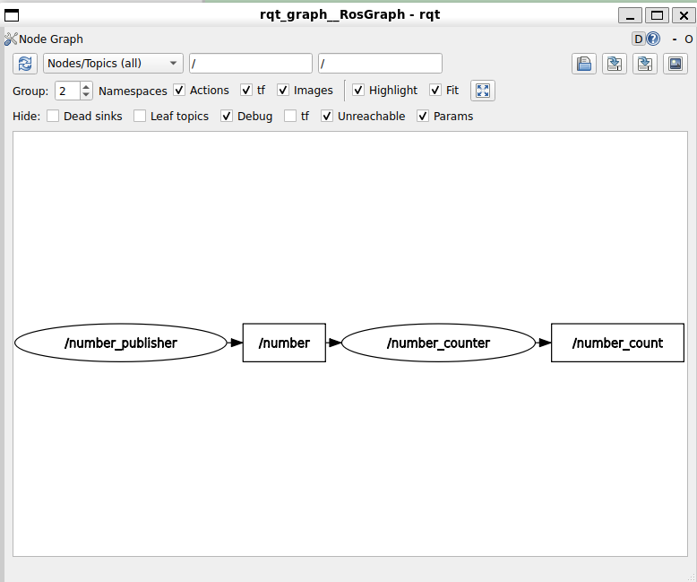

> 启动文件有三种方式：xml，yaml（极少人用），Python

> ROS2中，Python被大量用于编写启动文件 ~~这是ROS2初期的首选。不过目前正慢慢倾向于XML~~ 

> 注意，这里使用Python编写启动文件 ~~而不是节点~~ 

> 首先得创建一个包，并设置好安装启动文件的命令 ~~CMakeLists.txt中的install~~ 

> 下面这个上一讲做过了

```cmake
#提供指令：想要安装launch文件夹，以及launch文件夹
#内的所有内容
install(DIRECTORY
  launch
  # 将launch目录安装到 install/<package_name>/share/<package_name>/ 下
  DESTINATION share/${PROJECT_NAME}/
)
```

> `my_robot_bringup/launch` 中添加文件`number_app.launch.py`

```python
from launch import LaunchDescription
from launch_ros.actions import Node

#固定的generate_launch_description名字
def generate_launch_description():
    ld=LaunchDescription()

    #创建一个启动节点对象
    number_publisher=Node(
        package="my_py_pkg",
        executable="number_publisher"
    )

    #创建一个启动节点对象
    number_counter=Node(
        package="my_cpp_pkg",
        executable="number_counter"
    )

    #添加到LaunchDescription中
    ld.add_action(number_publisher)
    ld.add_action(number_counter)

    return ld
```

> 能不使用Python启动文件的情况下尽量不启用。XML启动文件中是可以导入Python启动文件的（为了兼容某些必须使用Python启动文件的场景）

> `my_robot_bringup/launch`中创建文件`number_app_from_python.lauch.xml`

```xml
<launch>

    <!-- 在 XML 启动文件中包含另一个启动文件 -->
    <!-- find-pkg-share 根据 ROS2 包名找到该包安装后的 share/package_name 目录 -->
    <!-- 后面跟着包名，这里是 my_robot_bringup，也可以是其他 ROS2 包 -->
    <!-- 该路径对应 CMakeLists.txt 中资源安装位置：
         DESTINATION share/${PROJECT_NAME}/ -->
    <!-- 展开后 /xxx/install/xx_pkg/share/xx_pkg 再拼/launch/number_app.launch.py (这里xx_pkg指的是my_robot_bringup)-->
    <include file="$(find-pkg-share my_robot_bringup)/launch/number_app.launch.py" />

</launch>
```

```bash
╭─ ~/HelloROS2/ros2_ws/src/my_robot_bringup main !1 ?1
╰─❯ ls ~/HelloROS2/ros2_ws/install/my_robot_bringup/share/my_robot_bringup/
cmake        launch            local_setup.sh   package.dsv  package.xml
environment  local_setup.bash  local_setup.zsh  package.ps1  package.zsh
hook         local_setup.dsv   package.bash     package.sh
```

> build,source

```bash
╭─ ~/HelloROS2/ros2_ws main !1 ?3
╰─❯ colcon build --packages-select my_robot_bringup
Starting >>> my_robot_bringup
Finished <<< my_robot_bringup [1.97s]

Summary: 1 package finished [2.47s]

╭─ ~/HelloROS2/ros2_ws main !1 ?3                                                 4s
╰─❯ source install/setup.zsh
```

> 使用Python文件启动

```bash
╭─ ~/HelloROS2/ros2_ws main !1 ?3
╰─❯ ros2 launch my_robot_bringup number_app.launch.py
[INFO] [launch]: All log files can be found below /home/ly/.ros/log/2026-10-12-21-18-06-261931-ubt24-1-24613
[INFO] [launch]: Default logging verbosity is set to INFO
[INFO] [number_publisher-1]: process started with pid [24616]
[INFO] [number_counter-2]: process started with pid [24617]
[number_counter-2] [INFO] [1791811086.760940240] [number_counter]: Number counter has been started.
[number_publisher-1] [INFO] [1791811087.885723278] [number_publisher]: Number publisher has been started.
```

> ctrl+c 停止上面，使用包含Python文件的xml启动文件启动

```bash
╭─ ~/HelloROS2/ros2_ws main !1 ?3
╰─❯ ros2 launch my_robot_bringup number_app.launch.xml
[INFO] [launch]: All log files can be found below /home/ly/.ros/log/2026-10-12-21-19-33-194479-ubt24-1-24719
[INFO] [launch]: Default logging verbosity is set to INFO
[INFO] [number_publisher-1]: process started with pid [24722]
[INFO] [number_counter-2]: process started with pid [24723]
[number_counter-2] [INFO] [1791811174.035855121] [number_counter]: Number counter has been started.
[number_publisher-1] [INFO] [1791811175.040527700] [number_publisher]: Number publisher has been started.

```

> 启动rqt_graph

```bash
╭─ ~/HelloROS2/ros2_ws main !1 ?3
╰─❯ rqt_graph
WARNING: CPU random generator seem to be failing, disabling hardware random number generation
WARNING: RDRND generated: 0xffffffff 0xffffffff 0xffffffff 0xffffffff

```



> 本课程的后续部分都会使用xml方式

