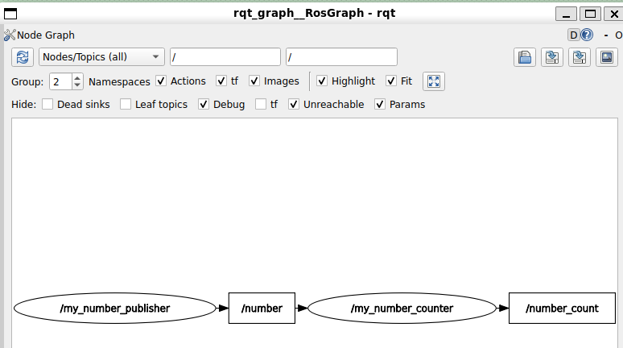
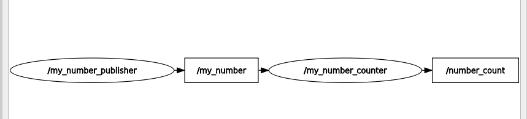

> 运行时重映射话题、重映射节点

```bash
╭─ ~/HelloROS2/ros2_ws main ✘ 254 1m 31s
╰─❯ ros2 run my_py_pkg number_publisher --ros-args -r __node:=abc -r number:=new_number
[INFO] [1791854216.751004999] [abc]: Number publisher has been started.

#话题列表
╭─ ~/HelloROS2/ros2_ws main
╰─❯ ros2 topic list
/new_number
/parameter_events
/rosout

#节点列表
╭─ ~/HelloROS2/ros2_ws main
╰─❯ ros2 node list
/abc

```

> 回顾

```bash
╭─ ~/HelloROS2/ros2_ws main !1
╰─❯ ros2 launch my_robot_bringup number_app.launch.xml
#启动了两个节点：my_number_counter和my_number_publisher
[INFO] [launch]: All log files can be found below /home/ly/.ros/log/2026-10-13-10-38-22-152010-ubt24-1-8003
[INFO] [launch]: Default logging verbosity is set to INFO
[INFO] [number_publisher-1]: process started with pid [8006]
[INFO] [number_counter-2]: process started with pid [8007]
[number_counter-2] [INFO] [1791859103.170673567] [my_number_counter]: Number counter has been started.
[number_publisher-1] [INFO] [1791859104.217375250] [my_number_publisher]: Number publisher has been started.
```

# xml方式

> 修改 number_app.launch.xml

```xml
<launch>
    <!--所有的内容都放在这个launch中-->
    <!--name 修改节点名称-->
    <node pkg="my_py_pkg" exec="number_publisher" name="my_number_publisher" />
    <node pkg="my_cpp_pkg" exec="number_counter" name="my_number_counter" />
</launch>
```

> 重新编译并构建功能包，加载构建后的环境，运行

```bash
╭─ ~/HelloROS2/ros2_ws main !1
╰─❯ colcon build --packages-select my_robot_bringup
Starting >>> my_robot_bringup
Finished <<< my_robot_bringup [1.82s]

Summary: 1 package finished [2.33s]

╭─ ~/HelloROS2/ros2_ws main !1                                                    4s
╰─❯ source install/setup.zsh

#运行并查看节点名已经修改
#这里不是ros2 run（运行）而是ros launch（启动）
╭─ ~/HelloROS2/ros2_ws main !1
╰─❯ ros2 launch my_robot_bringup number_app.launch.xml
[INFO] [launch]: All log files can be found below /home/ly/.ros/log/2026-10-13-10-49-25-919573-ubt24-1-8773
[INFO] [launch]: Default logging verbosity is set to INFO
[INFO] [number_publisher-1]: process started with pid [8776]
[INFO] [number_counter-2]: process started with pid [8777]
[number_counter-2] [INFO] [1791859766.765036682] [my_number_counter]: Number counter has been started.
[number_publisher-1] [INFO] [1791859768.314839932] [my_number_publisher]: Number publisher has been started.
```

```bash
╭─ ~/HelloROS2/ros2_ws main !1
╰─❯ ros2 node list
/my_number_counter
/my_number_publisher

╭─ ~/HelloROS2/ros2_ws main !1
╰─❯ rqt_graph
WARNING: CPU random generator seem to be failing, disabling hardware random number generation
WARNING: RDRND generated: 0xffffffff 0xffffffff 0xffffffff 0xffffffff
```

  

> 重映射话题名称

```xml
<launch>
    <!--所有的内容都放在这个launch中-->
    <!--name 修改节点名称-->
    <node pkg="my_py_pkg" exec="number_publisher" name="my_number_publisher">
        <!-- 重映射话题名称，对服务也有效果 -->
        <remap from="/number" to="/my_number" />
    </node>
    <node pkg="my_cpp_pkg" exec="number_counter" name="my_number_counter">
        <remap from="/number" to="/my_number" />
    </node>
</launch>
```

> build,source,launch

```bash

╭─ ~/HelloROS2/ros2_ws main !1
╰─❯ colcon build --packages-select my_robot_bringup
Starting >>> my_robot_bringup
Finished <<< my_robot_bringup [2.00s]

Summary: 1 package finished [2.45s]

╭─ ~/HelloROS2/ros2_ws main !1        
╰─❯ source install/setup.zsh

╭─ ~/HelloROS2/ros2_ws main !1
╰─❯ ros2 launch my_robot_bringup number_app.launch.xml
[INFO] [launch]: All log files can be found below /home/ly/.ros/log/2026-10-13-10-59-22-267367-ubt24-1-9751
[INFO] [launch]: Default logging verbosity is set to INFO
[INFO] [number_publisher-1]: process started with pid [9754]
[INFO] [number_counter-2]: process started with pid [9755]
[number_counter-2] [INFO] [1791860363.175436758] [my_number_counter]: Number counter has been started.
[number_publisher-1] [INFO] [1791860364.461561344] [my_number_publisher]: Number publisher has been started.

```

```bash
╭─ ~/HelloROS2/ros2_ws main !1
╰─❯ ros2 topic list
/my_number
/number_count
/parameter_events
/rosout

╭─ ~/HelloROS2/ros2_ws main !1
╰─❯ rqt_graph
WARNING: CPU random generator seem to be failing, disabling hardware random number generation
WARNING: RDRND generated: 0xffffffff 0xffffffff 0xffffffff 0xffffffff

```

  


# Python方式

> 修改number_app.launch.py

```python
from launch import LaunchDescription
from launch_ros.actions import Node


# 固定的generate_launch_description名字
def generate_launch_description():
    ld = LaunchDescription()

    # 创建一个启动节点对象
    number_publisher = Node(
        package="my_py_pkg",
        executable="number_publisher",
        name="my_number_publisher",
        #元组列表，为每个需要的重映射提供一个元组
        remappings=[("/number", "/my_number")],
    )

    # 创建一个启动节点对象
    number_counter = Node(
        package="my_cpp_pkg",
        executable="number_counter",
        name="my_number_counter",
        remappings=[("/number", "/my_number")],
    )

    # 添加到LaunchDescription中
    ld.add_action(number_publisher)
    ld.add_action(number_counter)

    return ld

```

```bash
#没有重新构建时不会生效的
╭─ ~/HelloROS2/ros2_ws main !2
╰─❯ ros2 launch my_robot_bringup number_app.launch.py
[INFO] [launch]: All log files can be found below /home/ly/.ros/log/2026-10-13-11-07-09-106950-ubt24-1-10474
[INFO] [launch]: Default logging verbosity is set to INFO
[INFO] [number_publisher-1]: process started with pid [10477]
[INFO] [number_counter-2]: process started with pid [10478]
[number_counter-2] [INFO] [1791860829.582233201] [number_counter]: Number counter has been started.
[number_publisher-1] [INFO] [1791860830.699297956] [number_publisher]: Number publisher has been started.

```

> 重新编译构建、source、launch

```bash
╭─ ~/HelloROS2/ros2_ws main !2
╰─❯ colcon build --packages-select my_robot_bringup
Starting >>> my_robot_bringup
Finished <<< my_robot_bringup [2.09s]

Summary: 1 package finished [2.55s]

╭─ ~/HelloROS2/ros2_ws main !2                                                    4s
╰─❯ source install/setup.zsh

╭─ ~/HelloROS2/ros2_ws main !2
╰─❯ ros2 launch my_robot_bringup number_app.launch.py
[INFO] [launch]: All log files can be found below /home/ly/.ros/log/2026-10-13-11-08-49-311613-ubt24-1-10639
[INFO] [launch]: Default logging verbosity is set to INFO
[INFO] [number_publisher-1]: process started with pid [10642]
[INFO] [number_counter-2]: process started with pid [10643]
[number_counter-2] [INFO] [1791860929.814652959] [my_number_counter]: Number counter has been started.
[number_publisher-1] [INFO] [1791860930.832084941] [my_number_publisher]: Number publisher has been started.

#查看
╭─ ~/HelloROS2/ros2_ws main !2
╰─❯ ros2 node list
/my_number_counter
/my_number_publisher

╭─ ~/HelloROS2/ros2_ws main !2
╰─❯ ros2 topic list
/my_number
/number_count
/parameter_events
/rosout
```

