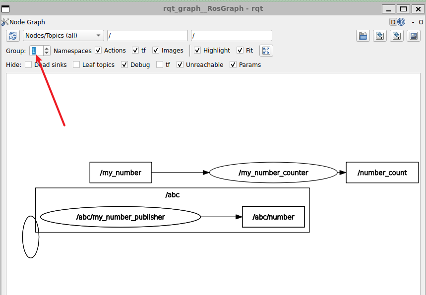
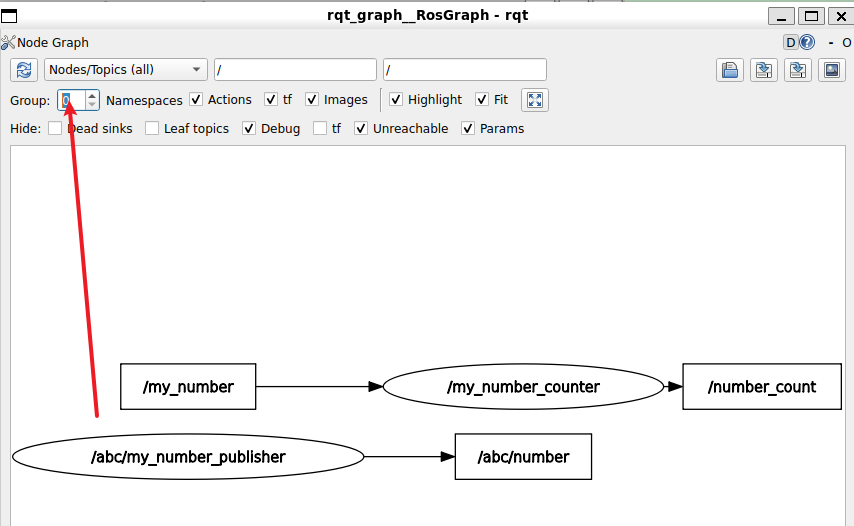
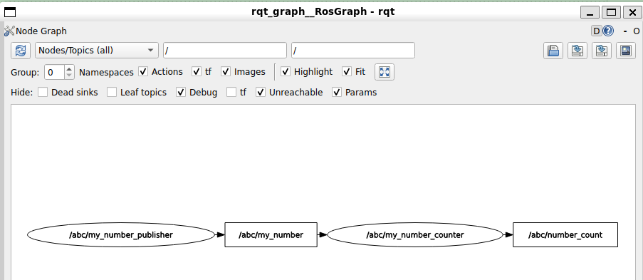
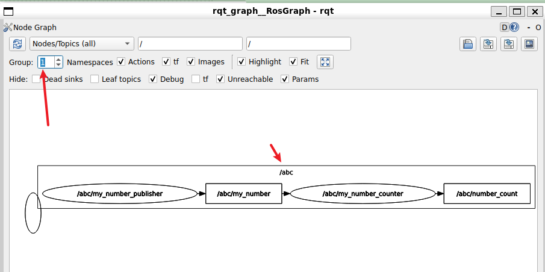

> 命名空间，这个概念不一定属于启动文件这部分，但由于主要在**启动文件**和**yaml**参数文件设置它们，所以在这里讲解

> 先从命名空间的概念开始，看看如何给节点添加命名空间，最后了解如何在启动文件中使用命名空间

> 回顾

```bash
#-r __node:=xxx 重映射节点名
#-r xx:=yy 重映射话题
╭─ ~/HelloROS2/ros2_ws main ✘ 254 1m 31s
╰─❯ ros2 run my_py_pkg number_publisher --ros-args -r __node:=abc -r number:=new_number
[INFO] [1791854216.751004999] [abc]: Number publisher has been started.

```

> 重新启动

```bash
╭─ ~/HelloROS2/ros2_ws main
╰─❯ ros2 run my_cpp_pkg number_publisher
[INFO] [1791876052.068446281] [number_publisher]: Number publisher has bee started.

╭─ ~/HelloROS2/ros2_ws main
╰─❯ ros2 node list
/number_publisher

╭─ ~/HelloROS2/ros2_ws main
╰─❯ ros2 topic list
/number
/parameter_events
/rosout
```


# 设置命名空间

```bash
╭─ ~/HelloROS2/ros2_ws main       2m 54s
╰─❯ ros2 run my_cpp_pkg number_publisher --ros-args -r __ns:=/test
[INFO] [1791876259.363288677] [test.number_publisher]: Number publisher has bee started.

```

> 当你给节点**添加命名空间**并启动它时，会改变内部所有的名称，包括**节点名称**、**话题名称**、**服务名称**  

```
#节点名和话题名称都添加上了 /test
╭─ ~/HelloROS2/ros2_ws main
╰─❯ ros2 node list
/test/number_publisher

╭─ ~/HelloROS2/ros2_ws main
╰─❯ ros2 topic list
/parameter_events
/rosout
/test/number
```

> 参数名称不会变

```bash
╭─ ~/HelloROS2/ros2_ws main
╰─❯ ros2 param list
/test/number_publisher:
  number
  qos_overrides./parameter_events.publisher.depth
  qos_overrides./parameter_events.publisher.durability
  qos_overrides./parameter_events.publisher.history
  qos_overrides./parameter_events.publisher.reliability
  start_type_description_service
  timer_period
  use_sim_time
```

# 命名空间的作用

> 注意，以下名称前没有添加斜杠`\`。如果不添加任何斜杠，系统会自动添加一个前导斜杠 

```python
#节点名
super().__init__("number_publisher")

#话题名称
self.number_publisher_ = self.create_publisher(Int64, "number", 10)

```

```bash
╭─ ~/HelloROS2/ros2_ws main
╰─❯ ros2 node list
/number_publisher

╭─ ~/HelloROS2/ros2_ws main
╰─❯ ros2 topic list
/number
/parameter_events
/rosout

```

> 即使代码中没有提供，这是自动添加的。即 它总是从所谓的**根命名空间**开始  ~~我觉得有点像Linux的路径，默认也是从 `\` 开始的~~ 

> 测试，在 number_publisher.py中，`self.number_publisher_ = self.create_publisher(Int64, "number", 10)` 修改为 `self.number_publisher_ = self.create_publisher(Int64, "/number", 10)` （即话题名称添加一个斜杠）

> 测试

```bash
╭─ ~/HelloROS2/ros2_ws main                                                       8s
╰─❯ colcon build --packages-select my_py_pkg --symlink-install
[1.578s] WARNING:colcon.colcon_core.package_selection:Some selected packages are already built in one or more underlay workspaces:
        'my_py_pkg' is in: /home/ly/HelloROS2/ros2_ws/install/my_py_pkg
If a package in a merged underlay workspace is overridden and it installs headers, then all packages in the overlay must sort their include directories by workspace order. Failure to do so may result in build failures or undefined behavior at run time.
If the overridden package is used by another package in any underlay, then the overriding package in the overlay must be API and ABI compatible or undefined behavior at run time may occur.

If you understand the risks and want to override a package anyways, add the following to the command line:
        --allow-overriding my_py_pkg

This may be promoted to an error in a future release of colcon-override-check.
Starting >>> my_py_pkg
Finished <<< my_py_pkg [7.05s]

Summary: 1 package finished [7.55s]


╭─ ~/HelloROS2/ros2_ws main        
╰─❯ source install/setup.zsh

╭─ ~/HelloROS2/ros2_ws main
╰─❯ ros2 run my_py_pkg number_publisher --ros-args -r __ns:=/test
[INFO] [1791878086.263716220] [test.number_publisher]: Number publisher has been started.


```

> 查看

```bash
╭─ ~/HelloROS2/ros2_ws main !1
╰─❯ ros2 node list
/test/number_publisher

╭─ ~/HelloROS2/ros2_ws main !1
╰─❯ ros2 topic list
/number 
/parameter_events
/rosout
```

> 原因是代码中已经添加了前导斜杠，已经明确指定是根命名空间了

> 如果代码中服务名称、节点名称、话题名称，没有添加任何斜杠，那么意味着可以添加任意数量的命名空间（这里是通过命令行时）

> 现在恢复无前导斜杠的代码

```bash

╭─ ~/HelloROS2/ros2_ws main         
╰─❯ ros2 run my_py_pkg number_publisher --ros-args -r __ns:=/test
[INFO] [1791878476.886534238] [test.number_publisher]: Number publisher has been started.

╭─ ~/HelloROS2/ros2_ws main   
╰─❯ ros2 topic list
/parameter_events
/rosout
/test/number

╭─ ~/HelloROS2/ros2_ws main
╰─❯ ros2 node list
/test/number_publisher

```

## 可以用来拆分应用程序

> 比如用于不同的机器人，命名空间非常有用

> 假设有三个不同机器人，每个机器人都有一个节点来控制轮子，这基本上是使用相同话题和服务等的同一个节点

> 如何确保每个机器人不会接收到另一个机器人的指令，不会搞乱轮子控制节点之间的通信？

可以让机器人1、机器人2、机器人3拥有不同的命名空间  

不需要更改代码，只需要在启动节点时添加命名空间即可

# 启动文件中添加命名空间

> 启动文件：`my_robot_bringup/launch/number_app_launch.xml`

```xml
<launch>
    <!--所有的内容都放在这个launch中-->
    <!--name 修改节点名称-->
    <!--namespace 修改命名空间 -->
    <node pkg="my_py_pkg" exec="number_publisher" name="my_number_publisher"
        namespace="/abc">
        <!-- 重映射话题名称，对服务也有效果 -->
        <remap from="/number" to="/my_number" />

        <!--在xml启动文件中包含param文件-->
        <param from="$(find-pkg-share my_robot_bringup)/config/number_app.yaml" />

        <!-- <param name="number" value="6" />
        <param name="timer_period" value="1.5" /> -->
    </node>
    <node pkg="my_cpp_pkg" exec="number_counter" name="my_number_counter">
        <remap from="/number" to="/my_number" />
    </node>
</launch>
```

> build,source,run

```bash
╭─ ~/HelloROS2/ros2_ws main !1
╰─❯ colcon build --packages-select my_robot_bringup
Starting >>> my_robot_bringup
Finished <<< my_robot_bringup [2.11s]

Summary: 1 package finished [2.60s]

╭─ ~/HelloROS2/ros2_ws main !1                                                    4s
╰─❯ source install/setup.zsh

╭─ ~/HelloROS2/ros2_ws main !1
╰─❯ ros2 launch my_robot_bringup number_app.launch.xml
[INFO] [launch]: All log files can be found below /home/ly/.ros/log/2026-10-13-16-09-12-968445-ubt24-1-26548
[INFO] [launch]: Default logging verbosity is set to INFO
[INFO] [number_publisher-1]: process started with pid [26551]
[INFO] [number_counter-2]: process started with pid [26552]
[number_counter-2] [INFO] [1791878953.924811165] [my_number_counter]: Number counter has been started.
[number_publisher-1] [INFO] [1791878955.200099553] [abc.my_number_publisher]: Number publisher has been started.
```
`
```bash
╭─ ~/HelloROS2/ros2_ws main !1
╰─❯ colcon build --packages-select my_robot_bringup
Starting >>> my_robot_bringup
Finished <<< my_robot_bringup [2.11s]

Summary: 1 package finished [2.60s]

╭─ ~/HelloROS2/ros2_ws main !1                                                    4s
╰─❯ source install/setup.zsh

╭─ ~/HelloROS2/ros2_ws main !1
╰─❯ ros2 launch my_robot_bringup number_app.launch.xml
[INFO] [launch]: All log files can be found below /home/ly/.ros/log/2026-10-13-16-09-12-968445-ubt24-1-26548
[INFO] [launch]: Default logging verbosity is set to INFO
[INFO] [number_publisher-1]: process started with pid [26551]
[INFO] [number_counter-2]: process started with pid [26552]
[number_counter-2] [INFO] [1791878953.924811165] [my_number_counter]: Number counter has been started.
[number_publisher-1] [INFO] [1791878955.200099553] [abc.my_number_publisher]: Number publisher has been started.
```


```bash
╭─ ~/HelloROS2/ros2_ws main !1
╰─❯ rqt_graph
WARNING: CPU random generator seem to be failing, disabling hardware random number generation
WARNING: RDRND generated: 0xffffffff 0xffffffff 0xffffffff 0xffffffff


```

  

  

> 这里有个问题，`/abc/number`没有被映射为`/abc/my_number`

因为 xml中  

```xml
        <remap from="/number" to="/my_number" />
```

应该修改为

```xml
        <remap from="number" to="my_number" />

```

当然，也可以使用： ~~但这种方式可拓展性不高~~     

```xml
<remap from="/abc/number" to="/abc/my_number" />
```

还修改了my_cpp_pkg的一些内容，以下是修改后完整的 `number_app_launch.xml`  

```xml
<launch>
    <!--所有的内容都放在这个launch中-->
    <!--name 修改节点名称-->
    <!--namespace 修改命名空间 -->
    <node pkg="my_py_pkg" exec="number_publisher" name="my_number_publisher"
        namespace="/abc">
        <!-- 重映射话题名称，对服务也有效果 -->
        <remap from="number" to="my_number" />

        <!--在xml启动文件中包含param文件-->
        <param from="$(find-pkg-share my_robot_bringup)/config/number_app.yaml" />

        <!-- <param name="number" value="6" />
        <param name="timer_period" value="1.5" /> -->
    </node>
    <node pkg="my_cpp_pkg" exec="number_counter" name="my_number_counter"
        namespace="/abc">
        <remap from="number" to="my_number" />
    </node>
</launch>
```

> build,source , launch

```bash
╭─ ~/HelloROS2/ros2_ws main !1
╰─❯ colcon build --packages-select my_robot_bringup
Starting >>> my_robot_bringup
Finished <<< my_robot_bringup [2.22s]

Summary: 1 package finished [2.73s]

╭─ ~/HelloROS2/ros2_ws main !1                                                    4s
╰─❯ source install/setup.zsh

╭─ ~/HelloROS2/ros2_ws main !1
╰─❯ ros2 launch my_robot_bringup number_app.launch.xml
[INFO] [launch]: All log files can be found below /home/ly/.ros/log/2026-10-13-16-18-41-080630-ubt24-1-27387
[INFO] [launch]: Default logging verbosity is set to INFO
[INFO] [number_publisher-1]: process started with pid [27390]
[INFO] [number_counter-2]: process started with pid [27391]
[number_counter-2] [INFO] [1791879521.819541344] [abc.my_number_counter]: Number counter has been started.
[number_publisher-1] [INFO] [1791879523.284469209] [abc.my_number_publisher]: Number publisher has been started.
```

```bash

╭─ ~/HelloROS2/ros2_ws main !1
╰─❯ ros2 topic list
/abc/my_number
/abc/number_count
/parameter_events
/rosout


╭─ ~/HelloROS2/ros2_ws main !1
╰─❯ ros2 topic list
/abc/my_number
/abc/number_count
/parameter_events
/rosout
```

  

  

# 在Python启动文件中添加命名空间

```python
from launch import LaunchDescription
from launch_ros.actions import Node
#获取包共享目录
from ament_index_python.packages import get_package_share_directory
import os


# 固定的generate_launch_description名字
def generate_launch_description():
    ld = LaunchDescription()

    param_config=os.path.join(get_package_share_directory("my_robot_bringup"),"config","number_app.yaml")

    # 创建一个启动节点对象
    number_publisher = Node(
        package="my_py_pkg",
        executable="number_publisher",
        name="my_number_publisher",
        namespace="/abc", #添加这行
        #元组列表，为每个需要的重映射提供一个元组
        remappings=[("number", "my_number")],#移除前导斜杠
        # parameters=[
        #     {"number": 12},
        #     {"timer_perior": 1.3}
        # ]
        parameters=[param_config]
    )

    # 创建一个启动节点对象
    number_counter = Node(
        package="my_cpp_pkg",
        executable="number_counter",
        namespace="/abc", #添加这行
        name="my_number_counter",
        remappings=[("number", "my_number")], #移除前导斜杠
    )

    # 添加到LaunchDescription中
    ld.add_action(number_publisher)
    ld.add_action(number_counter)

    return ld

```

> 测试

```bash
╭─ ~/HelloROS2/ros2_ws main !2
╰─❯ colcon build --packages-select my_robot_bringup
Starting >>> my_robot_bringup
Finished <<< my_robot_bringup [2.13s]

Summary: 1 package finished [2.59s]

╭─ ~/HelloROS2/ros2_ws main !2   
╰─❯ source install/setup.zsh

╭─ ~/HelloROS2/ros2_ws main !2                                                 ✘ INT
╰─❯ ros2 launch my_robot_bringup number_app.launch.py
[INFO] [launch]: All log files can be found below /home/ly/.ros/log/2026-10-13-16-24-03-959844-ubt24-1-27901
[INFO] [launch]: Default logging verbosity is set to INFO
[INFO] [number_publisher-1]: process started with pid [27904]
[INFO] [number_counter-2]: process started with pid [27905]
[number_counter-2] [INFO] [1791879844.456645398] [abc.my_number_counter]: Number counter has been started.
[number_publisher-1] [INFO] [1791879845.783757325] [abc.my_number_publisher]: Number publisher has been started.


```

> 查看

```bash
╭─ ~/HelloROS2/ros2_ws main !2
╰─❯ ros2 topic list
/abc/my_number
/abc/number_count
/parameter_events
/rosout

╭─ ~/HelloROS2/ros2_ws main !2
╰─❯ ros2 node list
/abc/my_number_counter
/abc/my_number_publisher
```