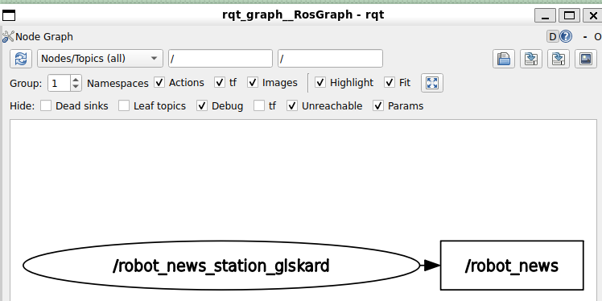
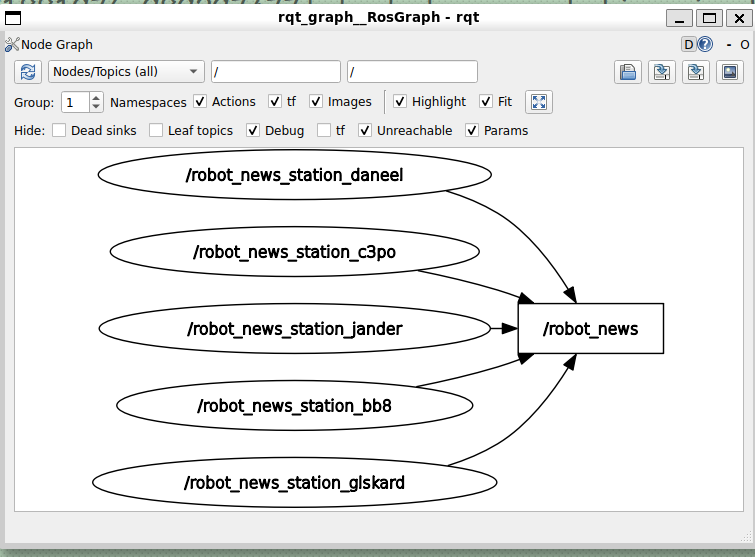
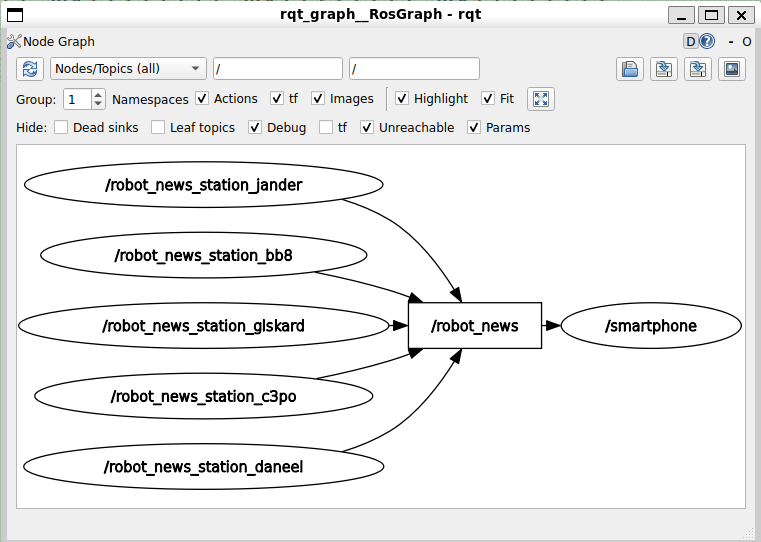
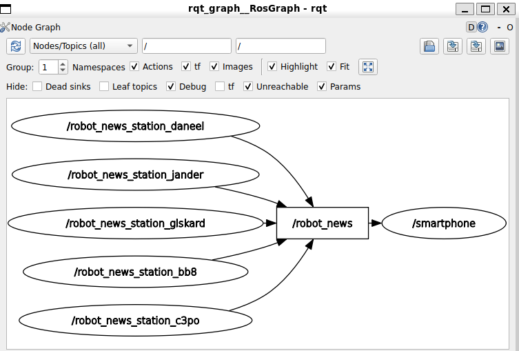

> 启动文件练习的解决方案：挑战启动一堆节点

结果图 


#  尝试逐步启动各个节点

```bash
╭─ ~/HelloROS2/ros2_ws main
╰─❯ ros2 run my_py_pkg robot_news_station --ros-args -r __node:=robot_news_station_glskard
[INFO] [1791880702.019166187] [robot_news_station_glskard]: Robot News Station has been started.


╭─ ~/HelloROS2/ros2_ws main
╰─❯ ros2 node list
/robot_news_station_glskard

╭─ ~/HelloROS2/ros2_ws main
╰─❯ ros2 topic list
/parameter_events
/robot_news
/rosout


╭─ ~/HelloROS2/ros2_ws main          11s
╰─❯ ros2 param list
/robot_news_station_glskard:
  robot_name
  start_type_description_service
  use_sim_time

```

> 设置参数后启动

```bash
╭─ ~/HelloROS2/ros2_ws main ✘ 254 1m 41s
╰─❯ ros2 run my_py_pkg robot_news_station --ros-args -r __node:=robot_news_station_glskard -p robot_name:="Glskard"
[INFO] [1791880829.423157163] [robot_news_station_glskard]: Robot News Station has been started.


#查询参数
╭─ ~/HelloROS2/ros2_ws main
╰─❯ ros2 param get /robot_news_station_glskard robot_name
String value is: Glskard
 
╭─ ~/HelloROS2/ros2_ws main
╰─❯ ros2 topic echo /robot_news
data: Hi, this is Glskard from the robot news station.
---
data: Hi, this is Glskard from the robot news station.
---
data: Hi, this is Glskard from the robot news station.
---
```

> 即：如果不确定启动文件该写什么（或者不知道对错），可以现在终端命令行写上并启动

# 使用xml启动节点

> 新建文件 `my_robot_bringup/launch/radio.launch.xml` 并编辑

```xml
<launch>
    <!--ros2 run my_py_pkg robot_news_station \-\-ros-args -r
    __node:=robot_news_station_glskard -p robot_name:="Glskard"-->
    <node pkg="my_py_pkg" exec="robot_news_station"
        name="robot_news_station_glskard">
        <param name="robot_name" value="Glskard" />
    </node>
</launch>
```

> 测试简单版本

```bash
╭─ ~/HelloROS2/ros2_ws main ?1
╰─❯ colcon build --packages-select my_robot_bringup
Starting >>> my_robot_bringup
Finished <<< my_robot_bringup [1.83s]

Summary: 1 package finished [2.36s]

╭─ ~/HelloROS2/ros2_ws main ?1    
╰─❯ source install/setup.zsh

╭─ ~/HelloROS2/ros2_ws main ?1
╰─❯ ros2 launch my_robot_bringup radio.launch.xml
[INFO] [launch]: All log files can be found below /home/ly/.ros/log/2026-10-13-16-48-41-459498-ubt24-1-30130
[INFO] [launch]: Default logging verbosity is set to INFO
[INFO] [robot_news_station-1]: process started with pid [30133]
[robot_news_station-1] [INFO] [1791881323.180249719] [robot_news_station_glskard]: Robot News Station has been started.

╭─ ~/HelloROS2/ros2_ws main ?1        6s
╰─❯ ros2 node list
/robot_news_station_glskard


╭─ ~/HelloROS2/ros2_ws main ?1
╰─❯ ros2 topic echo /robot_news
data: Hi, this is Glskard from the robot news station.
---
data: Hi, this is Glskard from the robot news station.
```

```bash
╭─ ~/HelloROS2/ros2_ws main ?1
╰─❯ rqt_graph
WARNING: CPU random generator seem to be failing, disabling hardware random number generation
WARNING: RDRND generated: 0xffffffff 0xffffffff 0xffffffff 0xffffffff
```




> 完整版本

```xml
<launch>
    <!--ros2 run my_py_pkg robot_news_station \-\-ros-args -r
    __node:=robot_news_station_glskard -p robot_name:="Glskard"-->
    <node pkg="my_py_pkg" exec="robot_news_station"
        name="robot_news_station_glskard">
        <param name="robot_name" value="Glskard" />
    </node>
    <node pkg="my_py_pkg" exec="robot_news_station"
        name="robot_news_station_bb8">
        <param name="robot_name" value="BB8" />
    </node>
    <node pkg="my_py_pkg" exec="robot_news_station"
        name="robot_news_station_daneel">
        <param name="robot_name" value="Daneel" />
    </node>
    <node pkg="my_py_pkg" exec="robot_news_station"
        name="robot_news_station_jander">
        <param name="robot_name" value="Jander" />
    </node>
    <node pkg="my_py_pkg" exec="robot_news_station"
        name="robot_news_station_c3po">
        <param name="robot_name" value="C3po" />
    </node>

</launch>
```

> build,source,launch

```bash
╭─ ~/HelloROS2/ros2_ws main ?1
╰─❯ colcon build --packages-select my_robot_bringup
Starting >>> my_robot_bringup
Finished <<< my_robot_bringup [1.95s]

Summary: 1 package finished [2.40s]


╭─ ~/HelloROS2/ros2_ws main ?1   
╰─❯ source install/setup.zsh

╭─ ~/HelloROS2/ros2_ws main ?1
╰─❯ ros2 launch my_robot_bringup radio.launch.xml
[INFO] [launch]: All log files can be found below /home/ly/.ros/log/2026-10-13-16-59-33-718059-ubt24-1-31039
[INFO] [launch]: Default logging verbosity is set to INFO
[INFO] [robot_news_station-1]: process started with pid [31042]
[INFO] [robot_news_station-2]: process started with pid [31043]
[INFO] [robot_news_station-3]: process started with pid [31044]
[INFO] [robot_news_station-4]: process started with pid [31045]
[INFO] [robot_news_station-5]: process started with pid [31046]
[robot_news_station-2] [INFO] [1791881976.250796800] [robot_news_station_bb8]: Robot News Station has been started.
[robot_news_station-1] [INFO] [1791881976.481049328] [robot_news_station_glskard]: Robot News Station has been started.
[robot_news_station-3] [INFO] [1791881976.813488600] [robot_news_station_daneel]: Robot News Station has been started.
[robot_news_station-5] [INFO] [1791881976.939440994] [robot_news_station_c3po]: Robot News Station has been started.
[robot_news_station-4] [INFO] [1791881976.989297477] [robot_news_station_jander]: Robot News Station has been started.
```

```bash
╭─ ~/HelloROS2/ros2_ws main ?1
╰─❯ rqt_graph
WARNING: CPU random generator seem to be failing, disabling hardware random number generation
WARNING: RDRND generated: 0xffffffff 0xffffffff 0xffffffff 0xffffffff
```

  


> 接收到所有发布者的所有不同消息，并带有不同名字

```bash
╭─ ~/HelloROS2/ros2_ws main ?1
╰─❯ ros2 topic echo /robot_news
data: Hi, this is Glskard from the robot news station.
---
data: Hi, this is Jander from the robot news station.
---
data: Hi, this is BB8 from the robot news station.
---
data: Hi, this is Daneel from the robot news station.
---
data: Hi, this is C3po from the robot news station.
---
data: Hi, this is Glskard from the robot news station.
---
data: Hi, this is Jander from the robot news station.
---
data: Hi, this is BB8 from the robot news station.
---
data: Hi, this is Daneel from the robot news station.
---
```

> 修改 radio.launch.xml ~~添加smartphone~~ 

```xml
<launch>
    <!--ros2 run my_py_pkg robot_news_station \-\-ros-args -r
    __node:=robot_news_station_glskard -p robot_name:="Glskard"-->
    <node pkg="my_py_pkg" exec="robot_news_station"
        name="robot_news_station_glskard">
        <param name="robot_name" value="Glskard" />
    </node>
    <node pkg="my_py_pkg" exec="robot_news_station"
        name="robot_news_station_bb8">
        <param name="robot_name" value="BB8" />
    </node>
    <node pkg="my_py_pkg" exec="robot_news_station"
        name="robot_news_station_daneel">
        <param name="robot_name" value="Daneel" />
    </node>
    <node pkg="my_py_pkg" exec="robot_news_station"
        name="robot_news_station_jander">
        <param name="robot_name" value="Jander" />
    </node>
    <node pkg="my_py_pkg" exec="robot_news_station"
        name="robot_news_station_c3po">
        <param name="robot_name" value="C3po" />
    </node>

    <node pkg="my_py_pkg" exec="smartphone" />
</launch>
```

> 运行

```bash
╭─ ~/HelloROS2/ros2_ws main ?1
╰─❯ colcon build --packages-select my_robot_bringup
Starting >>> my_robot_bringup
Finished <<< my_robot_bringup [2.06s]

Summary: 1 package finished [2.46s]

╭─ ~/HelloROS2/ros2_ws main ?1        4s
╰─❯ source install/setup.zsh             
╭─ ~/HelloROS2/ros2_ws main ?1
╰─❯ ros2 launch my_robot_bringup radio.launch.xml
[INFO] [launch]: All log files can be found below /home/ly/.ros/log/2026-10-13-17-04-56-667296-ubt24-1-31678
[INFO] [launch]: Default logging verbosity is set to INFO
[INFO] [robot_news_station-1]: process started with pid [31684]
[INFO] [robot_news_station-2]: process started with pid [31685]
[INFO] [robot_news_station-3]: process started with pid [31686]
[INFO] [robot_news_station-4]: process started with pid [31687]
[INFO] [robot_news_station-5]: process started with pid [31688]
[INFO] [smartphone-6]: process started with pid [31689]
```

```bash
╭─ ~/HelloROS2/ros2_ws main ?1
╰─❯ rqt_graph                            WARNING: CPU random generator seem to be failing, disabling hardware random number generation
WARNING: RDRND generated: 0xffffffff 0xffffffff 0xffffffff 0xffffffff
```

 

# 使用yaml文件设置参数

> 新建文件`my_robot_bringup/config/radio_config.yaml`

```yaml
/robot_news_station_giskard:
  ros__parameters:
    robot_name: "Giskard"

/robot_news_station_bb8:
  ros__parameters:
    robot_name: "BB8"

/robot_news_station_daneel:
  ros__parameters:
    robot_name: "Daneel"

/robot_news_station_jander:
  ros__parameters:
    robot_name: "Jander"

/robot_news_station_c3po:
  ros__parameters:
    robot_name: "C3po"


```

> 修改 `radio.launch.xml`

```xml
<launch>
    <!--ros2 run my_py_pkg robot_news_station \-\-ros-args -r
    __node:=robot_news_station_glskard -p robot_name:="Glskard"-->
    <node pkg="my_py_pkg" exec="robot_news_station"
        name="robot_news_station_glskard">
        <!-- <param name="robot_name" value="Glskard" /> -->
        <param from="$(find-pkg-share my_robot_bringup)/config/radio_config.yaml" />
    </node>
    <node pkg="my_py_pkg" exec="robot_news_station"
        name="robot_news_station_bb8">
        <!-- <param name="robot_name" value="BB8" /> -->
        <param from="$(find-pkg-share my_robot_bringup)/config/radio_config.yaml" />
    </node>
    <node pkg="my_py_pkg" exec="robot_news_station"
        name="robot_news_station_daneel">
        <!-- <param name="robot_name" value="Daneel" /> -->
        <param from="$(find-pkg-share my_robot_bringup)/config/radio_config.yaml" />
    </node>
    <node pkg="my_py_pkg" exec="robot_news_station"
        name="robot_news_station_jander">
        <!-- <param name="robot_name" value="Jander" /> -->
        <param from="$(find-pkg-share my_robot_bringup)/config/radio_config.yaml" />
    </node>
    <node pkg="my_py_pkg" exec="robot_news_station"
        name="robot_news_station_c3po">
        <!-- <param name="robot_name" value="C3po" /> -->
        <param from="$(find-pkg-share my_robot_bringup)/config/radio_config.yaml" />
    </node>

    <node pkg="my_py_pkg" exec="smartphone" />
</launch>
```

```bash
╭─ ~/HelloROS2/ros2_ws main ?1
╰─❯ colcon build --packages-select my_robot_bringup
Starting >>> my_robot_bringup
Finished <<< my_robot_bringup [3.90s]

Summary: 1 package finished [4.49s]
 

╭─ ~/HelloROS2/ros2_ws main !1 ?1    
╰─❯ source install/setup.zsh

╭─ ~/HelloROS2/ros2_ws main !1 ?1
╰─❯ colcon build --packages-select my_robot_bringup
Starting >>> my_robot_bringup
Finished <<< my_robot_bringup [1.90s]

Summary: 1 package finished [2.30s]

╭─ ~/HelloROS2/ros2_ws main !1 ?1   
╰─❯ source install/setup.zsh

#启动节点
╭─ ~/HelloROS2/ros2_ws main !1 ?1
╰─❯ ros2 launch my_robot_bringup radio.launch.xml
[INFO] [launch]: All log files can be found below /home/ly/.ros/log/2026-10-13-17-17-33-872777-ubt24-1-33300
[INFO] [launch]: Default logging verbosity is set to INFO
[INFO] [robot_news_station-1]: process started with pid [33303]
[INFO] [robot_news_station-2]: process started with pid [33304]
[INFO] [robot_news_station-3]: process started with pid [33305]
[INFO] [robot_news_station-4]: process started with pid [33306]
[INFO] [robot_news_station-5]: process started with pid [33307]
[INFO] [smartphone-6]: process started with pid [33308]
[robot_news_station-1] [INFO] [1791883056.678679136] [robot_news_station_glskard]: Robot News Station has been started.
[robot_news_station-5] [INFO] [1791883056.945582175] [robot_news_station_c3po]: Robot News Station has been started.
[robot_news_station-3] [INFO] [1791883057.299395494] [robot_news_station_daneel]: Robot News Station has been started.
[robot_news_station-4] [INFO] [1791883057.609340336] [robot_news_station_jander]: Robot News Station has been started.
[robot_news_station-2] [INFO] [1791883057.699672580] [robot_news_station_bb8]: Robot News Station has been started.
[smartphone-6] [INFO] [1791883057.725546247] [smartphone]: Smartphone has been started.
[smartphone-6] [INFO] [1791883058.049559588] [smartphone]: Hi, this is Jander from the robot news station.
[smartphone-6] [INFO] [1791883058.162118006] [smartphone]: Hi, this is BB8 from the robot news station.
[smartphone-6] [INFO] [1791883058.326468193] [smartphone]: Hi, this is Daneel from the robot news station.
[smartphone-6] [INFO] [1791883058.328446875] [smartphone]: Hi, this is Daneel from the robot news station.
[smartphone-6] [INFO] [1791883058.548339737] [smartphone]: Hi, this is Jander from the robot news station.
[smartphone-6] [INFO] [1791883058.665017903] [smartphone]: Hi, this is BB8 from the robot news station.
[smartphone-6] [INFO] [1791883058.751550011] [smartphone]: Hi, this is Daneel from the robot news station.
[smartphone-6] [INFO] [1791883059.047829966] [smartphone]: Hi, this is Jander from the robot news station.
[smartphone-6] [INFO] [1791883059.164757380] [smartphone]: Hi, this is BB8 from the robot news station.
[smartphone-6] [INFO] [1791883059.253088854] [smartphone]: Hi, this is Daneel from the robot news station.
```

```bash
╭─ ~/HelloROS2/ros2_ws main !1 ?1
╰─❯ rqt_graph
WARNING: CPU random generator seem to be failing, disabling hardware random number generation
WARNING: RDRND generated: 0xffffffff 0xffffffff 0xffffffff 0xffffffff
```




