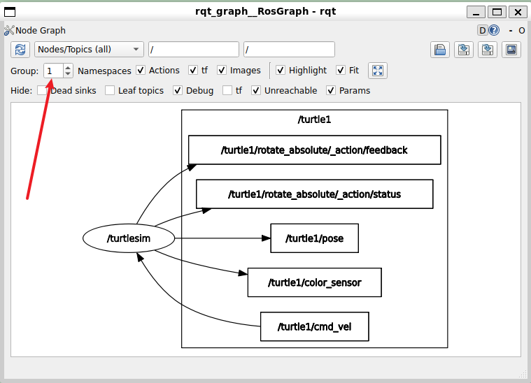
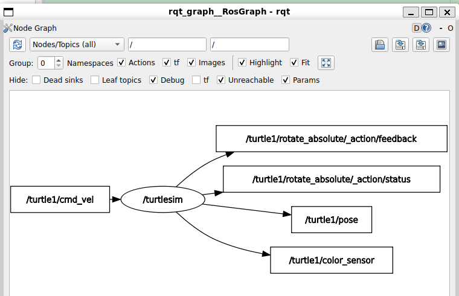

> 第一步，让海龟动起来，即启动海龟模拟器，让海龟到达地图上的某个特定点

# 先启动海龟模拟器，查看话题、服务

```bash
╭─ ~/HelloROS2/ros2_ws main
╰─❯ ros2 run turtlesim turtlesim_node
WARNING: CPU random generator seem to be failing, disabling hardware random number generation
WARNING: RDRND generated: 0xffffffff 0xffffffff 0xffffffff 0xffffffff
[INFO] [1791886647.611726565] [turtlesim]: Starting turtlesim with node name /turtlesim
[INFO] [1791886647.692924833] [turtlesim]: Spawning turtle [turtle1] at x=[5.544445], y=[5.544445], theta=[0.000000]


```

```bash
╭─ ~/HelloROS2/ros2_ws main
╰─❯ ros2 topic list
/parameter_events
/rosout
/turtle1/cmd_vel #给 turtle1 发送速度指令
/turtle1/color_sensor
/turtle1/pose  #海龟当前的位置和姿态信息
```

```bash
╭─ ~/HelloROS2/ros2_ws main
╰─❯ ros2 topic echo /turtle1/pose
x: 5.544444561004639 #居中的时候是(5.5,5.5)，所有最大值右上角最远应该是(11,11)
y: 5.544444561004639
theta: 0.0 #意味着指向正右侧，从正右侧往上往左最多旋转360回到原来的方向
linear_velocity: 0.0
angular_velocity: 0.0
---
x: 5.544444561004639
y: 5.544444561004639
theta: 0.0
linear_velocity: 0.0
angular_velocity: 0.0

╭─ ~/HelloROS2/ros2_ws main
╰─❯ ros2 topic hz /turtle1/pose
average rate: 62.518 #1秒钟62次
        min: 0.014s max: 0.018s std dev: 0.00076s window: 64
average rate: 62.503
        min: 0.012s max: 0.019s std dev: 0.00098s window: 127
average rate: 62.479
        min: 0.011s max: 0.022s std dev: 0.00107s window: 190
```

```bash

```

> rqt图查看

  

> 如图，右边那些方框的话题都属于`/turtle1`命名空间

  

总结一下 /turtlesim 在这个图中的角色：

- 作为订阅者：订阅 `/turtle1/cmd_vel`（接收速度指令）。
- 作为发布者：发布 `/turtle1/pose`（位姿）、/turtle1/color_sensor（颜色传感器数据）、以及 Action 的反馈和状态信息。

> 我们会使用`/turtle1/cmd_vel` 和 `/turtle1/pose` ，我们将获取当前位置，然后根据该位置发送新的命令速度

# 节点编写

> 安装包，这里使用Python解决方案

```bash
#创建包，使用ament_python，添加依赖rclpy turtlesim
╭─ ~/HelloROS2/ros2_ws/src main
╰─❯ ros2 pkg create turtlesim_catch_them_all --build-type ament_python --dependencies rclpy turtlesim
going to create a new package
package name: turtlesim_catch_them_all
destination directory: /home/ly/HelloROS2/ros2_ws/src
package format: 3
version: 0.0.0
description: TODO: Package description
maintainer: ['ly <lwmfjc@gmail.com>']
licenses: ['TODO: License declaration']
build type: ament_python
dependencies: ['rclpy', 'turtlesim']
creating folder ./turtlesim_catch_them_all
creating ./turtlesim_catch_them_all/package.xml
creating source folder
creating folder ./turtlesim_catch_them_all/turtlesim_catch_them_all
creating ./turtlesim_catch_them_all/setup.py
creating ./turtlesim_catch_them_all/setup.cfg
creating folder ./turtlesim_catch_them_all/resource
creating ./turtlesim_catch_them_all/resource/turtlesim_catch_them_all
creating ./turtlesim_catch_them_all/turtlesim_catch_them_all/__init__.py
creating folder ./turtlesim_catch_them_all/test
creating ./turtlesim_catch_them_all/test/test_copyright.py
creating ./turtlesim_catch_them_all/test/test_flake8.py
creating ./turtlesim_catch_them_all/test/test_pep257.py

[WARNING]: Unknown license 'TODO: License declaration'.  This has been set in the package.xml, but no LICENSE file has been created.
It is recommended to use one of the ament license identifiers:
Apache-2.0
BSL-1.0
BSD-2.0
BSD-2-Clause
BSD-3-Clause
GPL-3.0-only
LGPL-3.0-only
MIT
MIT-0
```

> 首先需要一个订阅者来订阅`/turtle1/pose`，然后还需要要给发布者发布到`/turtle1/cmd_vel`

## 查看

```bash
╭─ ~/HelloROS2/ros2_ws main ?1
╰─❯ ros2 topic info /turtle1/pose
Type: turtlesim/msg/Pose
Publisher count: 1
Subscription count: 0

╭─ ~/HelloROS2/ros2_ws main ?1
╰─❯ ros2 interface show turtlesim/msg/Pose
#位置
float32 x
float32 y
float32 theta

#线速度和角速度
float32 linear_velocity
float32 angular_velocity
```

> 所以需要为 `/turtle1/pose` 创建一个订阅者

------

```
```bash
╭─ ~/HelloROS2/ros2_ws main ?1
╰─❯ ros2 topic info /turtle1/cmd_vel
Type: geometry_msgs/msg/Twist
Publisher count: 0
Subscription count: 1
```

> 我们需要为`/turtle1/cmd_vel` 创建一个发布者

------

