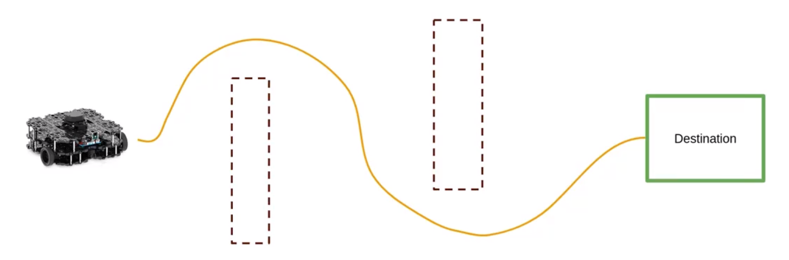
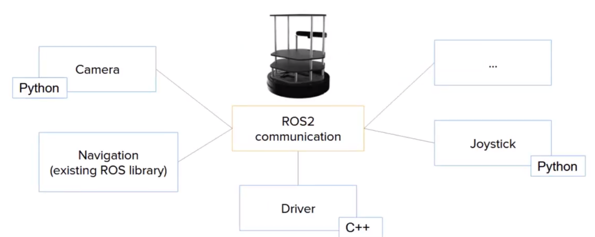

# Hello

> 前提：已经掌握了ROS2基础知识，想继续学习 Nav2 stack
> 包括ROS2基础、Python基础、使用LInux终端、ROS2终端

> 课程结束时：将对Nav2有清晰的理解；如何使用它；利用实践知识来进一步发展机器人项目；即使没有实体机器人也可以使用gazebo中的模拟机器人来完成工作

> 本课程，将通过实验来发现导航堆栈，在模拟机器人上进行slam以生成地图，然后使用地图，将让机器人导航。在了解导航堆栈如何工作的实际概述后，进一步探讨如何在gazebo中创建自定义模拟世界，还将发现自定义机器人适应堆栈所需的步骤

> 最后将编写一些代码来直接与现有ros应用程序交互导航

# 什么是Nav2Stack

> ros的主要优点是，可以创建你的机器人应用的基础层

ROS 2 的优势

- 能够极快地创建底层架构
- 为机器人应用提供标准
- 适用于任意机器人
- 让你避免重复造轮子
- 活跃的开源社区
- 即插即用的功能包

> 如何让一个机器人导航

使用Navigation2Stack：使用一系列的包设计来实现一个特定的目标；确切的想要用导航来实现什么？

> 让机器人以安全的方式从点A移动到点B；找到一条路径让机器人到达目的地、不会与其他机器人、人、障碍物相撞

  

分成几个步骤：

- 使用slam创建环境的地图
- 将使用这个地图让机器人导航

所有这些都使用导航功能和工具来实现

  
一旦理解就可以轻松将nav堆栈集成到应用中

举例：

- 一个独立的Python节点，可以向堆栈提供commands，让机器人仅使用标准的通信导航以及简化的API

# 如何充分利用这门课程

- ros2基础知识
- 跟着操作
- 之后得观看Nav2文档在课程后期

