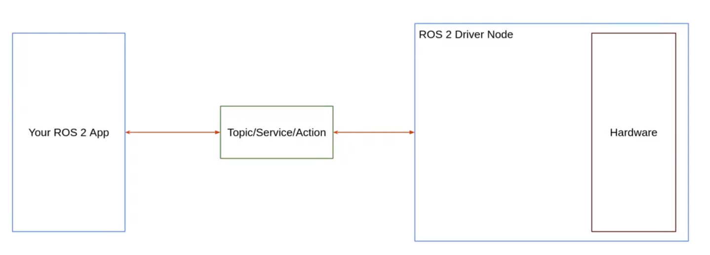
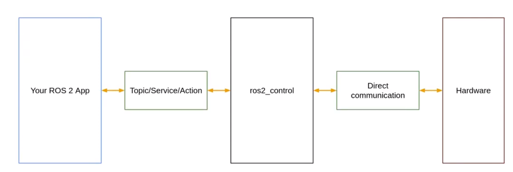

# Welcome

> ros2应用与真实硬件通信

> 前提：具有ros基础，了解packages，c++ nodes，topics，callbacks，URDF，RViz，lifecycle nodes

> 本课程中会：

- 搭建ROS2_control 管道，并理解每个组件的作用
- 如果用C++正确设计一个硬件驱动、如何将它与ROS结合使用
    - 编写自定义的硬件接口、自定义的控制器
- 与真实的电机一起工作
- 将ros2_control与Gazebo模拟器集成

# 为什么需要ros2_control

> 假设左边有一个ros2应用，右边有一个电机、传感器

如何让他们协同工作  

> 简单场景

  
> 复杂：还需要控制机器人手臂、或移动底盘，还有一些传感器

> 如果需要快速的控制，比如每秒500(500Hz)，如果使用ros2通信开销太大了

当然，这种情况下使用C++比Python更好。此时的硬件控制器不应该使用ROS2的topic、service、action，并且也应该使用C++

> 还可能需要一个或多个控制器，来获取要执行的指令，并为每个关节计算一些插值或加速度，以便让硬件平稳移动

## ros2_control

  
在ROS2应用和ros2_control之间仍然有ROS2通信。但之后，你的ROS2control管道将仅通过C++代码直接与硬件对话，开销极小  

优点：

- 高性能
- 很多模块
    - 以不同的方式设置控制器和硬件接口
- 有现成的控制器，例如 插值指令、控制轮子、机器人手臂关节等
- 与其他ROS2技术栈： Navigation2或者Moveit2有很好的兼容性 ~~如果想使用它们，ROS2Control几乎是必不可少的一步~~ 
- 基本上可以把课程中所做的复制到任何其他的ROS2项目中